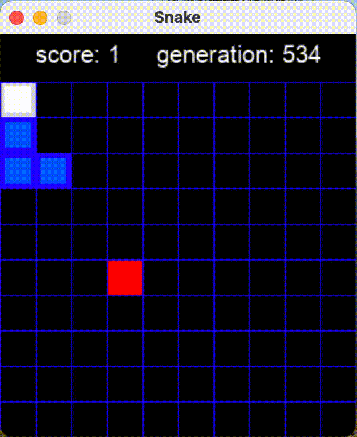

# 贪吃蛇神经进化（Snake Neuroevolution）

<p align="center">
    
</p>

> **一句话概括**：这是一个在 10×10 棋盘上，用**遗传算法、强化学习、世界模型、搜索规划**等多条技术路线让 AI 自己学会玩贪吃蛇的实验平台；所有神经网络（MLP、卷积、反向传播）均用 **NumPy 手写**，不依赖深度学习框架，界面用 pygame 实现。
>
> **进一步说**：项目不是单一算法，而是一条完整的研究主线——从遗传算法进化 MLP 权重出发，依次尝试纯 NumPy DQN、Dreamer 式世界模型、环境克隆束搜索（beam search），最后以哈密顿回路在任意尺寸棋盘上稳定吃满。成功的路线产品化进菜单，失败的路线（POMDP 信息丢失、学习型前向模型失效）也完整保留，并在开发日志中记录了证伪过程。

---

## 目录

- [一、效果速览](#一效果速览)
- [二、菜单的 8 个模式](#二菜单的-8-个模式)
- [三、目录结构](#三目录结构)
- [四、快速开始](#四快速开始)
- [五、训练脚本](#五训练脚本)
- [六、模型存档说明](#六模型存档说明)
- [七、技术路线与关键结论](#七技术路线与关键结论)
- [八、文档与演示视频](#八文档与演示视频)

---

## 一、效果速览

### 10×10 棋盘各方法对比（`compare.py`，30 局）

| 方法 | 状态表征 | 平均得分 | 峰值 / 备注 |
| --- | --- | --- | --- |
| 遗传算法 + MLP | 局部 32 维观测 | 26.3 | 峰值 99（满分），偶发满分 |
| NumPy DQN | 局部 42 维（网络取前 40 维） | 13.2 | 训练平台约 15~20 分 |
| CNN-DQN | 完整棋盘 6 通道网格 | 平台 16~18 | 40 万步训练后瓶颈 |
| 世界模型 Dreamer | 局部观测 + 隐空间想象 | 0.7 | 被 POMDP 证伪，保留为实验记录 |
| 离线束搜索 | 环境克隆 + flood fill | **97.4** | 峰值 99，多局吃满 |
| 哈密顿回路 | 全局结构化回路 | **99.0** | 30/30 全部满分，0 死亡 |

> 棋盘满分 = 格数 − 1（蛇初始占 1 格），10×10 满分即 99。

### 大棋盘：全局回路（`global_cycle`）泛化结果

| 棋盘尺寸 | 10×10 | 11×11 | 12×12 | 14×14 | 15×15 |
| --- | --- | --- | --- | --- | --- |
| 吃满得分 | 99 | 119 | 143 | 195 | 223 |
| 死亡数 | 0 | 0 | 0 | 0 | 0 |

构造方法：去角格 (0,0) + 结构化双列锯齿生成合法哈密顿回路；15×15 上有限深度束搜索只能达到 78~84% 填充率，而全局回路可以三局全部吃满。

---

## 二、菜单的 8 个模式

运行 `python launcher.py` 进入图形菜单，共 8 张模式卡片，鼠标点击进入。

| # | 模式名 | 内部 key | 菜单副标题 |
| --- | --- | --- | --- |
| 1 | 手动玩 | `human` | 方向键转向，蛇自动前进 |
| 2 | AI 自动玩 | `ai` | 遗传算法连续进化，可暂停 |
| 3 | 路径 AI | `path` | 哈密顿回路，零训练保证满分 |
| 4 | 最佳回放 | `pretrained` | 回放最强蛇，同分选步数最少 |
| 5 | DQN 强化学习 | `dqn` | 闭环试错，奖励驱动自主学习 |
| 6 | CNN 深度规划 | `cnn` | 多步空间前瞻，实时安全决策 |
| 7 | 世界模型 Dreamer | `world` | 学内部模型，在想象中规划 |
| 8 | 离线束搜索 | `beam` | 多路径深度规划，逼近吃满 |

### 1. 手动玩（human）

人类玩家模式。方向键控制转向，蛇以固定帧率自动前进，禁止 180° 直接反向；吃苹果加分、撞墙或撞自己身体结束。用于直观感受规则和 AI 决策的参照系。代码：`human_game.py`。

### 2. AI 自动玩（ai）

遗传算法（GA）在线进化模式。每一代 100 条蛇各自对局，按适应度 `(score + 1/steps) × 100000` 评估，经轮盘赌选择、单点交叉、高斯变异产生下一代；网络为 32-20-12-4 的 MLP（964 个基因）。界面可暂停，周期存档到 `genes/`。代码：`main.py`、`ai_game.py`、`nn.py`。

### 3. 路径 AI（path）

经典搜索 + 哈密顿回路模式，**零训练、确定性满分**。包含两档能力：BFS 最短路径控制器（带逃生检查，避免吃完食物后无路可走），以及构造性哈密顿回路控制器（沿回路循环即可吃满全图）。代码：`path_game.py`。

### 4. 最佳回放（pretrained）

加载 `genes/record/` 下的历史最强基因（当前为 99 分纪录），在对应随机种子下逐帧复现对局。选择规则：先按分数、同分再按步数最少择优。代码入口：`launcher.run_replay`。

### 5. DQN 强化学习（dqn）

深度 Q 网络（纯 NumPy 实现）闭环试错模式。智能体在 `SnakeEnv` 中以 ε-贪婪探索，经验回放 + 目标网络 + Huber 损失 + Adam 优化，从奖励信号中自主学习状态→动作价值。环境产出 42 维局部状态，网络取前 40 维（与旧 checkpoint 逐位兼容）。代码：`dqn_agent.py`、`q_network.py`、`replay_buffer.py`、`rl_env.py`。

### 6. CNN 深度规划（cnn）

完整可观测空间下的卷积网络模式。输入为 6 通道棋盘网格（蛇身、蛇头、食物、访问计数、气味等），NumPy 手写卷积 + 池化 + 全连接提取空间特征；决策时叠加 flood fill 连通空间奖励做实时安全前瞻。代码：`cnn_dqn_agent.py`、`cnn_safe_agent.py`、`conv.py`、`cnn_qnet.py`。

### 7. 世界模型 Dreamer（world）

模型基强化学习模式。先训练内部世界模型（编码器 + 隐空间动力学 + 解码器），智能体在"想象"的轨迹中用 λ-return 规划策略，再作用于真实环境。该路线在本项目中被局部可观测性（POMDP）证伪——2 万局仅出现 52 种不同局部观测，信息从根上不足以支撑决策；代码与分阶段存档完整保留，供学习失败案例。代码：`dreamer_agent.py`、`latent_world_model.py`、`build_world.py`、`train_policy.py`。

### 8. 离线束搜索（beam）

不依赖任何 Q 网络的纯规划模式，也是学习型方法之外的最强产品档。每一步在环境**克隆**上做束搜索：展开多条候选动作序列，用 flood fill 评估安全空间、tail-reachability 保证能追上自己的尾巴、BFS 引导向食物，并配合随体长变化的动态饥饿期限。10×10 确定可复现，均分 97.4、峰值 99。代码：`cnn_beam_agent.py`。

---

## 三、目录结构

```
snake-main/
├── launcher.py              # 图形启动器：8 模式菜单与统一对局循环
├── settings.py              # 全局常量：棋盘 10×10、网络结构、GA 参数
├── theme.py                 # 菜单/界面主题（渐变、卡片、图标、字体缓存）
│
├── ── 手动与遗传算法线 ──
├── human_game.py            # 手动模式
├── ai_game.py               # GA 对局环境（Snake/Game，含循环检测）
├── main.py                  # GA 进化主流程（选择/交叉/变异/存档）
├── nn.py                    # 早期 MLP 积木
├── mlp.py                   # 通用全连接层积木
│
├── ── 强化学习线（DQN / CNN-DQN）──
├── rl_env.py                # SnakeEnv：local/full/grid 三种表征、能量与生存模式
├── base_agent.py            # 智能体基类
├── dqn_agent.py             # DQN 智能体（含状态维度裁剪适配）
├── q_network.py             # Q 网络（NumPy MLP）
├── replay_buffer.py         # 经验回放池
├── train_rl.py              # DQN 训练器
├── conv.py                  # NumPy 卷积/池化层（前向+反向）
├── cnn_qnet.py              # 卷积 Q 网络
├── cnn_dqn_agent.py         # CNN-DQN 智能体
├── cnn_safe_agent.py        # flood fill 安全空间智能体
├── cnn_lookahead_agent.py   # 多步前瞻智能体
├── cnn_imagined_agent.py    # 前向模型想象智能体
├── train_cnn.py             # CNN-DQN 训练器
│
├── ── 搜索规划线 ──
├── path_game.py             # BFS 控制器 + 哈密顿回路构造与校验
├── cnn_beam_agent.py        # 环境克隆束搜索（beam search）
│
├── ── 世界模型线（Dreamer / W5 实验）──
├── latent_world_model.py    # 隐空间世界模型
├── dreamer_agent.py         # Dreamer 智能体（λ-return 想象规划）
├── build_world.py           # 世界模型训练器
├── train_policy.py          # 想象策略训练器
├── latent_grid_model.py     # 保分辨率隐变量网格模型（W5，已证伪）
├── grid_forward_model.py    # 全卷积前向模型（W5，已证伪）
├── train_world_cnn.py       # CNN 世界模型训练器
├── train_world_fixed.py     # 冻结世界模型训练器
├── train_dyna.py            # Dyna 式在线规划训练器
│
├── ── 评估与历史实验 ──
├── compare.py               # 各方法横向对比评估
├── exp_energy.py            # 能量代谢实验（stay 动作 + 饿死机制）
├── exp_survival.py          # 缩身生存模式实验
├── exp_adj.py               # 输入特征消融实验（40 维 vs 32 维）
│
├── ── 模型存档目录 ──
├── genes/                   # GA 基因存档（含 99 分纪录与历史种群）
├── dqn_ckpt/                # DQN 生产 checkpoint（40 维）
├── dqn_ckpt_32dim/          # 旧 32 维 DQN 存档
├── dqn_ckpt_full/           # 完整 300 维表征 DQN 存档
├── cnn_ckpt/                # CNN-DQN 与世界模型 CNN 存档
├── dreamer_ckpt/            # Dreamer 分阶段存档（stage_0~9）
├── dyna_ckpt/               # Dyna 退化版存档（勿用于生产）
│
├── ── 其他 ──
├── movie/                   # Manim 讲解视频工程（含 bgm.mp3）
├── seed/                    # 随机种子存档
├── logs/                    # 运行日志
├── _scratch/                # 验证/体检/诊断脚本（约 80 个）
├── _backup_global_v1/       # 全局气味改造前备份
├── _backup_local_scent/     # 局部气味版本备份
├── world_frozen.npz         # 冻结世界模型参数
├── snake.gif                # 演示动图
├── typical_death_1/2.png    # 典型死亡案例归档图
├── DQN开发日志.md           # 完整开发日志（原理、踩坑、bug 修复）
├── requirements.txt         # 依赖
├── .gitignore
├── 启动贪吃蛇.bat / 静默启动.vbs / 贪吃蛇.lnk   # Windows 快捷启动
└── README.md
```

根目录共 36 个产品级 `.py` 文件；`_scratch/` 内的 `check_health*.py`、`verify_*.py`、`smoke_launcher.py` 等是验证脚本，不属于产品代码。

---

## 四、快速开始

**环境要求**：Python 3.10+（开发验证于 3.13）、pygame、NumPy。

```bash
# 1. 安装依赖（仅 pygame + numpy；神经网络全部手写，不需要 torch）
pip install -r requirements.txt

# 2. 启动图形菜单
python launcher.py
```

Windows 用户也可直接双击 `启动贪吃蛇.bat`，或通过 `静默启动.vbs` 无控制台窗口启动。

无显示环境下做自动化验证时，可设置 `SDL_VIDEODRIVER=dummy` 让 pygame 使用无头渲染。

---

## 五、训练脚本

菜单模式加载的都是已训练好的存档；如需重新训练，按下表运行对应脚本：

| 脚本 | 作用 |
| --- | --- |
| `python main.py` | 遗传算法进化 MLP，周期写入 `genes/` |
| `python train_rl.py` | 训练 DQN（支持 local / full / energy / survival 模式） |
| `python train_cnn.py` | 训练完整棋盘表征的 CNN-DQN |
| `python build_world.py` | 训练 Dreamer 世界模型（编码-动力学-解码） |
| `python train_policy.py` | 在已训练世界模型中训练想象策略 |
| `python train_world_cnn.py` | 训练保分辨率 CNN 前向模型（W5） |
| `python train_world_fixed.py` | 冻结世界模型后训练策略头 |
| `python train_dyna.py` | Dyna 式"真实经验 + 规划想象"交替训练 |
| `python compare.py` | 横向对比各方法多局成绩 |

---

## 六、模型存档说明

| 存档 | 内容 | 被谁加载 |
| --- | --- | --- |
| `genes/record/` | 99 分纪录基因（`genes`、`score.txt`、`seed`、`steps.txt`） | 最佳回放 |
| `genes/myrun_v1_964/pop/` | 100 个历史种群个体文件 | GA 热启动/研究 |
| `dqn_ckpt/final.npz` | 40 维 DQN 生产权重 | 菜单 DQN 模式（`state[:40]`） |
| `dqn_ckpt_32dim/` | 早期 32 维版本，消融对照 | 实验脚本 |
| `dqn_ckpt_full/` | 300 维完整表征版本 | 实验脚本 |
| `cnn_ckpt/best.npz` | CNN-DQN 最佳权重 | 菜单 CNN 模式 |
| `cnn_ckpt/world_cnn.npz` | CNN 世界模型权重 | 想象/规划智能体 |
| `cnn_ckpt/grid_forward.npz` | 网格前向模型权重 | 前向模型想象 |
| `dreamer_ckpt/` | Dreamer 10 个阶段 + latest + final | 菜单世界模型模式 |
| `dyna_ckpt/` | Dyna 退化版，仅作历史记录 | 无生产入口 |
| `world_frozen.npz` | 冻结的世界模型参数 | 冻结规划实验 |

---

## 七、技术路线与关键结论

技术演进按 **GA → NumPy DQN → 世界模型 → 环境克隆规划 → 哈密顿回路** 推进，每一步的结论如下：

1. **遗传算法（GA）**：直接进化 MLP 的 964 个权重基因，无需梯度即可得到有效策略，纪录个体可达 99 分，但平均水平一般（26.3），适应度对绕圈行为约束弱。
2. **纯 NumPy DQN**：手写 Q 网络、经验回放、目标网络与 Adam，验证了梯度路线可行；局部观测下平台 15~20 分，撞自己身体是主要死因。
3. **POMDP 诊断（关键转折）**：统计发现 2 万局对局仅产生 52 种不同局部观测——蛇看不到全局，信息在观测端就已丢失，任何只吃局部观测的方法都有天花板。Dreamer 世界模型（W1–W3）因此失败。
4. **完整可观测 + CNN-DQN**：改用 6 通道完整棋盘网格与手写卷积，成绩提升到 16~18 分平台，但学习型 Q 网络仍受泛化瓶颈限制。
5. **学习型前向模型被证伪（W5）**：隐空间 Dreamer-lite 的奖励头泛化失败；保分辨率前向模型的 done 头在稀有事件（死亡）上失效。两条路线均保留代码与存档。
6. **环境克隆束搜索（成功）**：放弃学习动力学，直接克隆真实环境做确定性前瞻，配合 flood fill、tail-reachability 与动态饥饿期限，均分 97.4、峰值 99，且修复克隆漏存随机数状态的 bug 后逐位可复现。
7. **哈密顿回路（终局方案）**：在可构造回路的棋盘上，沿全局回路行进即可零训练、零死亡吃满；`global_cycle` 统一入口支持 10/11/12/14/15 五种尺寸全部吃满。

> 失败的实验没有删除：被证伪的假设本身就是结论，`DQN开发日志.md` 记录了每一步的原理和数据。

---

## 八、文档与演示视频

- **`DQN开发日志.md`**：完整开发日志，包含每个迭代的原理、实验数据、9 个代码 bug 的发现与修复、17 项功能体检结果，是阅读本项目代码的首选配套文档。
- **`movie/`**：基于 Manim 的项目讲解视频工程（`movie/main.py`，背景音乐 `bgm.mp3`），如需渲染视频需额外安装 manim。
- 项目上级目录另有 4 份研究文档：`贪吃蛇AI优化调研报告.md`、`贪吃蛇AI优化总结-提速与拔高.md`、`DQN贪吃蛇训练方案.md`、`世界模型梦境调研-Dreamer.md`。

---

## 致谢

本项目遗传算法部分参考自 [Chrispresso/SnakeAI](https://github.com/Chrispresso/SnakeAI)，后续 DQN、世界模型、束搜索与哈密顿回路部分均为在此基础上的独立改造与扩展。
